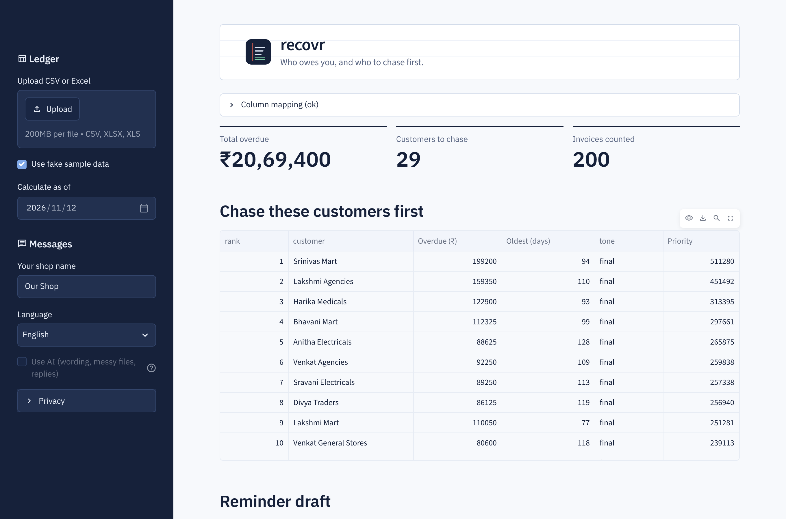
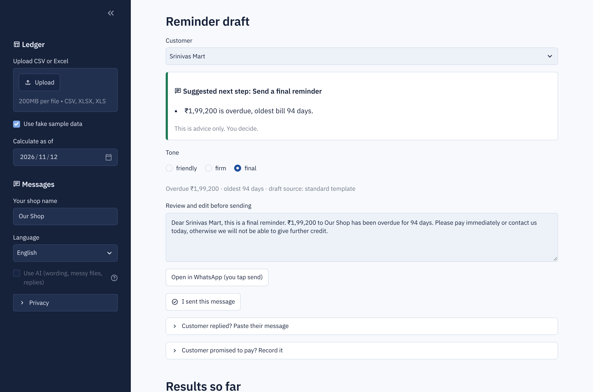
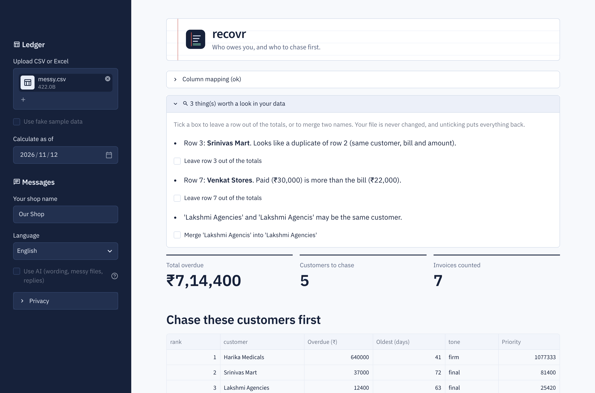
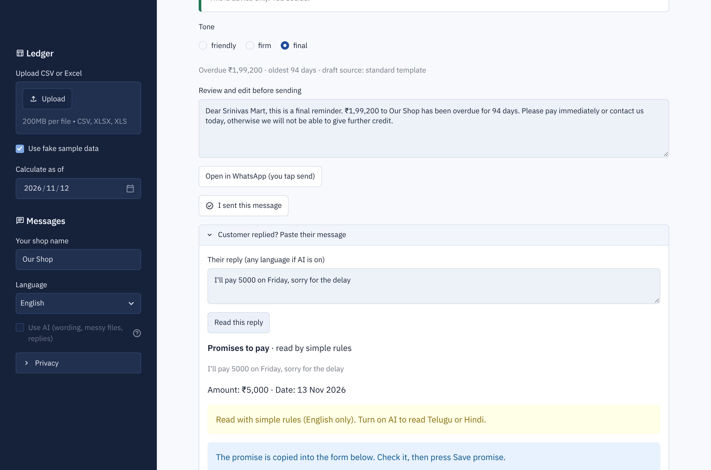
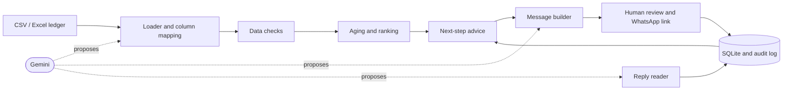

# recovr

[](https://github.com/sindhusali/recovr/actions/workflows/ci.yml)

**AI-assisted overdue-payment follow-up for small shops and distributors who sell on credit.**

Upload a messy ledger, see who owes you and who to chase first, get a ready-to-send reminder in English, Telugu or Hindi, and track promises and money recovered. The AI only *proposes*; code checks every result and the shopkeeper approves every message.

> All screenshots below use **fake data** generated by `scripts/make_sample_data.py`.



## The problem

Small businesses in India often wait 45-90 days to be paid and chase invoices by hand, or not at all. Their ledgers are messy spreadsheets exported from Tally, Busy or Zoho, or typed by hand. Existing finance tools assume clean data and a finance team.

## What it does

| Feature | How it works |
|---|---|
| **Smart ledger import** | Handles title rows above the header, `;` and tab files, odd encodings, Indian `dd/mm/yyyy` dates, ISO dates and `₹12,500`-style amounts. Unknown column names are matched by fixed aliases first, then (optionally) by AI. |
| **Data checks** | Flags duplicates, overpaid bills, an extra zero in an amount, impossible dates and near-identical names. The shopkeeper can leave a row out or merge two names, without the file being changed. |
| **Aging and ranking** | Splits what each customer owes into Current / 1-30 / 31-60 / 60+ days, then ranks by an explainable score (overdue amount, scaled up to 3x for age). |
| **Reminders** | Templates in English, Telugu and Hindi with three tones. Optional AI rewrite, accepted only if it keeps every fact. Opens a WhatsApp chat with the message filled in; the shopkeeper taps send. |
| **Reply reading** | Paste a customer's WhatsApp reply ("I'll pay 5000 on Friday"); it extracts the intent, amount and date, which the shopkeeper confirms before saving a promise. |
| **Next-step advice** | Rules over the customer's real history: wait for a promise, follow up on a missed one, call after several ignored reminders, pause credit after repeated broken promises. |
| **Results and audit trail** | Reminders sent, promises kept or broken, money recovered, and an append-only activity log. |







## Design decisions

**1. The AI proposes, code validates, a human approves.** An LLM can be wrong in ways that cost money, so it never has the last word.

| Where AI is used | What it may do | What code checks |
|---|---|---|
| Reminder wording | Rephrase a finished message | The exact amount and customer name are still present, and the set of numbers is identical (nothing added, dropped or changed). Otherwise the fixed template is used. |
| Column matching | Suggest which column is which | Every column exists, is used once, and holds the right kind of data (a text column cannot be an amount). The user confirms on screen. |
| Reply reading | Extract intent, amount and date | The date is real, not in the past, within 120 days and consistent with any weekday the customer named; the amount is positive and not above what is owed. Failures are dropped with a warning. |
| Advice summary | Explain a decision made by rules | It may not introduce any number that is not in the facts. |

If the API is down, slow or unconfigured, every feature falls back to a rule-based version, and every AI call has a time limit (20 seconds by default), so a slow network can never freeze the app.

**2. Amounts, dates and names are filled in by code, never by the LLM.**

**3. Privacy by design.**
- For column matching, the LLM never sees ledger values. It receives only header names and a locally computed profile such as "number" or "date shaped 99/99/9999".
- Only the last 4 digits of a phone number are stored; customer replies are not stored, only what was read from them.
- Real data lives in `data/real/`, which is git-ignored, and one button erases the whole database.

**4. Money is exact.** Amounts use `Decimal` in memory and integer paise in SQLite, so `0.10 + 0.20` is exactly `0.30`.

**5. The audit log is append-only, enforced by the database.** SQLite triggers reject `UPDATE` and `DELETE` on it, so even a bug cannot rewrite history. A test proves it.

**6. Nothing is sent automatically.** The app produces a WhatsApp link; the shopkeeper reviews, edits and taps send. This avoids message-sending mistakes and WhatsApp's rules on automated messaging.

**7. Explainable ranking and advice.** A shopkeeper can be told *why* someone is ranked first. There is no black box.

## Architecture



```
app/
├── main.py            Streamlit page; no business logic
├── ui.py              look and feel (CSS, header, advice-card colours)
├── static/            bundled IBM Plex Sans font (OFL) and logo
├── config.py          settings from .env
├── ai/                shared Gemini client (timeout, fails soft)
├── domain/            models, aging, ranking, advice, money formatting
├── ingestion/         loader, smart_mapping, quality checks, cleaning
├── messaging/         templates, LLM rewrite, validation, reply parser, WhatsApp links
└── storage/           SQLite schema, repository, audit log
tests/                 pytest suite
scripts/               fake-data generator, Gemini connection check
```

## Run it

Requires Python 3.11+.

```bash
git clone https://github.com/sindhusali/recovr.git
cd recovr
python -m venv .venv
# Windows: .venv\Scripts\activate      macOS/Linux: source .venv/bin/activate
pip install -r requirements.txt

python scripts/make_sample_data.py     # fake ledger for the demo
streamlit run app/main.py
```

### Optional: turn on AI

1. Get a free key at <https://aistudio.google.com>.
2. Copy `.env.example` to `.env` and paste the key after `GEMINI_API_KEY=`.
3. Run `python scripts/check_ai.py` to confirm it works, then tick **Use AI** in the sidebar.

The app works fully without a key.

## Tests

```bash
pytest          # 129 tests
ruff check .    # lint
```

CI runs both on every push. The tests never call the real Gemini API; AI behaviour is tested with simulated model responses, including wrong ones (invented amounts, dropped deadlines, invalid dates, crashes).

## Limitations

- Single user, runs locally. There is no login, multi-user support or hosting setup yet.
- WhatsApp messages are sent by hand through a link, not through the WhatsApp Business API.
- The Telugu and Hindi templates should be reviewed by native speakers before real use.
- Reply reading without AI understands English only.
- The AI paths other than reminder rewriting are covered by tests with simulated responses; they have not yet been exercised against the live model across many real examples.
- Ranking weights and the advice rules are sensible defaults, not tuned on real collections data.

## Results from pilots

*Not yet measured.* This section will report real numbers (overdue amount at the start, amount recovered, days faster to payment) once the tool has been used with real shops. Nothing here is estimated.

## Roadmap

- Pilot with local shops and record before/after results
- Native-speaker review of Telugu and Hindi templates
- Per-customer payment-behaviour history across uploads
- Optional WhatsApp Business API integration
- Hosted multi-user version with login
